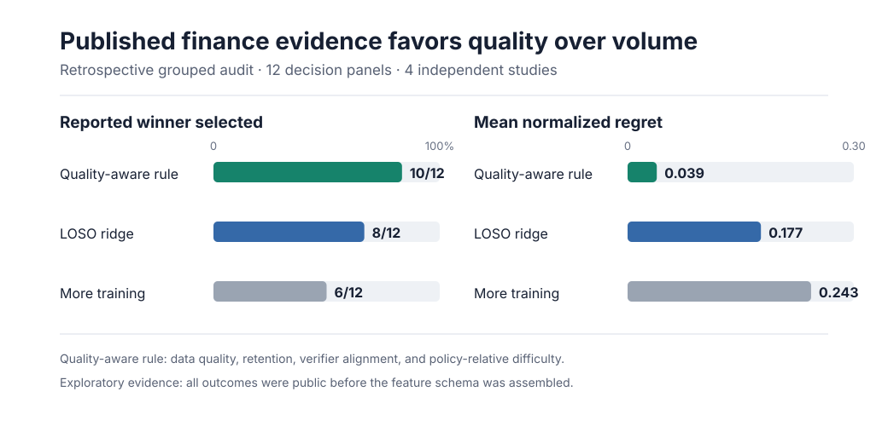

# Predicting which finance training environments will work

Finance agents are moving from document retrieval toward workflows that reconcile
records, investigate exceptions, prepare accounting entries, and act through
controlled tools. The open research question is no longer only whether an agent
can complete one task. It is whether we can predict which training experience
will improve that agent before committing a large post-training budget.

Anarres studies that decision directly:

> Given a starting policy and a fixed training budget, which measurable finance
> environment will produce the most held-out improvement while preserving
> material controls?

## What is complete

### Published intervention evidence

We normalized 47 reported intervention and control arms across 12 comparable
decision panels from four finance post-training studies. Every study is held
out in turn when fitting the exploratory ridge model.



A transparent quality-aware rule selects the reported winner in 10 of 12
panels. A leave-one-study-out ridge model selects 8 of 12 and has substantially
better magnitude calibration. Choosing the arm with the most training selects 6
of 12. The evidence suggests that reasoning-data quality, capability retention,
verifier alignment, and policy-relative difficulty matter more than volume
alone. Because the feature schema was assembled after the studies were public,
this is retrospective evidence rather than a prospective validation.

### Executable workflow qualification

Four stateful finance workflows passed strict generator checks across five seeds
each. All 20 workflow-seed trials passed deterministic-oracle, null-agent,
negative-control, handbook-citation, and state-identity checks. This qualifies a
source for prospective construction. It does not reveal which training mixture
will work best.

### Domain selection

The primary operational target is reconciliation and controlled exception
handling. These tasks have exact records, planted breaks, asymmetric error costs,
reviewable evidence, and explicit approval or escalation rules. They also match
the direction of current finance-agent systems. [Ramp Accounting
Bench](https://labs.ramp.com/accountingbench) evaluates agents across ledgers,
bank statements, invoices, and reconciliation workbooks. [Anthropic's finance
agents](https://www.anthropic.com/news/finance-agents) emphasize close workflows,
tool permissions, audit logs, and human review. [Bank of England and FCA survey
evidence](https://www.bankofengland.co.uk/report/2026/artificial-intelligence-in-uk-financial-services-2026)
places most deployed financial agents in decision-support roles and finds that
Operations and IT is the largest area of reported AI use.

## The prospective tests

The first prospective experiment uses the qualified accounting workflows. It
will compare matched finance-task distributions under one starting policy,
trainer, tool contract, and budget. Candidate and held-out scenario identities
will be committed before training. Candidate construction will not read
trained-policy outcomes.

The comparison includes:

1. a source-proportional mixture
2. a size-matched static-difficulty mixture
3. a policy-relative usable-signal mixture
4. a policy-relative mixture with an explicit workflow-coverage constraint.

The primary outcome is held-out executable completion. Reconciliation precision,
exception recall, ledger consistency, evidence provenance, approval violations,
unauthorized state changes, tool cost, and generated tokens remain separately
visible. A high aggregate score cannot erase a material-control failure.

The next panel extends the same decision to post-trade reconciliation and
exception handling. FINOS Common Domain Model provides lifecycle semantics,
while RecBench, TradeOpsSim, and FinRCA-Bench inform the data and evaluation
contract. None is yet admitted as the claim-bearing generator. The post-trade
panel begins only after its discrepancy generator and precision-first evaluator
pass the same deterministic-oracle, negative-control, identity, and licensing
gates.

## Why this result would matter

Finance-agent teams currently compare models, prompts, tools, skills, and task
sets through expensive end-to-end runs. A validated environment-utility model
would add an earlier decision point: measure candidate experience under the
starting policy, estimate its finite-budget return, and train only after the
selection and uncertainty are recorded.

The present evidence supports that research direction but does not yet establish
the selector. The decisive result will be the untouched prospective comparison,
including whether the predictor changes a real allocation decision relative to
the quality-aware and volume-based baselines.

## Questions for finance practitioners

The study is designed to incorporate domain knowledge before the prospective
contract is frozen. The most useful input concerns:

- which reconciliation or exception families consume the most review effort
- which false matches, missed breaks, or unsupported actions carry material cost
- which evidence and approvals are required before an action is permitted
- which workflow boundaries should remain separate evaluation endpoints
- what improvement would justify the cost of measuring candidate environments.

These questions refine the task and control contract. They do not expose or
change held-out outcomes after training begins.

## Inspect and reproduce

- [Retrospective methods and interpretation](retrospective-post-training/README.md)
- [Machine-readable panels](retrospective-post-training/data/panels.json)
- [Machine-readable results](retrospective-post-training/results/summary.json)
- [Prospective protocol](environment-selection/README.md)
- [Qualified-source record](environment-selection/PREFLIGHT.json)
- [Post-trade panel specification](environment-selection/POST_TRADE_PANEL_SPEC.md)

```bash
cd experiments/finance/retrospective-post-training
python scripts/reproduce.py
python scripts/render_summary.py
python test_reproduce.py
```

The source registry pins paper versions, repository revisions, licenses, and the
evidence admitted from each source.
