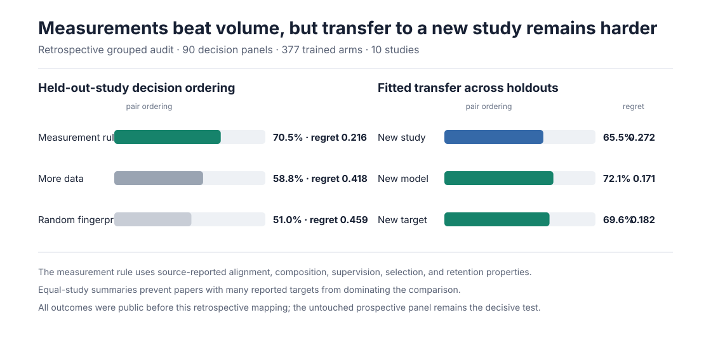

# Predicting which finance training environments will work

Finance agents are moving from document retrieval toward workflows that reconcile
records, investigate exceptions, prepare accounting entries, and act through
controlled tools. The open research question is no longer only whether an agent
can complete one task. It is whether we can predict which training experience
will improve that agent before committing a large post-training budget.

Anarres studies that decision directly:

> Given a starting policy and a fixed training budget, which measurable finance
> environment will produce the most held-out improvement while preserving
> material controls?

## What is complete

### Published intervention evidence

The source-recovered bridge contains 538 intervention and control arms across
149 comparable decision panels from sixteen finance post-training studies. Every
study is held out in turn for the strictest retrospective test.



Under leave-one-study-out evaluation, an interpretable measurement rule orders
64.3% of candidate pairs with 0.304 mean normalized regret. Choosing more data
orders 56.0% with 0.489 regret. The measurement rule also falls below the fifth
percentile of regret from 200 within-panel shuffled-pairing controls. A grouped
ridge predicts outcome magnitude better but allocates less reliably across a
new study. When the study is known, ridge transfer to a held-out model reaches
76.9% pair ordering and 0.152 regret. Transfer to a held-out target reaches
74.1% and 0.162. The difference between within-program transfer and new-study
transfer defines the current boundary.

With each study receiving equal weight, the expanded rule reaches 75.3% pair
ordering and 0.170 regret, compared with 58.2% and 0.421 for more data. It has
lower regret in thirteen of sixteen studies, ties in one, and loses in two.
Removing any one source preserves the direction. A publication-date sensitivity
fits the learned relationship on seven studies from 2024--2025 and evaluates
nine 2026 sources, where the full ridge reaches 72.8% ordering and 0.248 regret.
These checks strengthen the retrospective relationship without converting it
into a prospective result. Removing any one coordinate from the practical rule
or varying ridge regularization over a 32-fold range preserves the main
ordering advantage.
Within-panel rank normalization preserves the direction. The
[normalization audit](retrospective-post-training/NORMALIZATION_AUDIT.md)
records both weighting levels and the paired source comparison.

The evidence suggests that task alignment, reasoning-data quality, capability
retention, verifier design, policy-relative difficulty, and data composition
carry more decision information than volume alone. Because every outcome was
already public, this remains retrospective evidence rather than prospective
validation.

### Executable workflow qualification

Four stateful finance workflows passed strict generator checks across five seeds
each. All 20 workflow-seed trials passed deterministic-oracle, null-agent,
negative-control, handbook-citation, and state-identity checks. This qualifies a
source for prospective construction. It does not reveal which training mixture
will work best.

### Domain selection

The primary operational target is reconciliation and controlled exception
handling. These tasks have exact records, planted breaks, asymmetric error costs,
reviewable evidence, and explicit approval or escalation rules. They also match
the direction of current finance-agent systems. [Ramp Accounting
Bench](https://labs.ramp.com/accountingbench) evaluates agents across ledgers,
bank statements, invoices, and reconciliation workbooks. [Anthropic's finance
agents](https://www.anthropic.com/news/finance-agents) emphasize close workflows,
tool permissions, audit logs, and human review. [Bank of England and FCA survey
evidence](https://www.bankofengland.co.uk/report/2026/artificial-intelligence-in-uk-financial-services-2026)
places most deployed financial agents in decision-support roles and finds that
Operations and IT is the largest area of reported AI use.

This priority is also reflected in current systems and public benchmarks.
Anthropic includes ledger reconciliation, month-end close, statement audit,
KYC, and valuation review among its finance-agent templates. Ramp emphasizes
reconciliation, journal entries, accruals, variance analysis, and controlled
spend workflows. OpenAI's Endex case study highlights financial-model
reconciliation and source-linked discrepancy detection. FinBalance and
FORCE-Bench provide public evaluation designs for document-grounded accounting,
ERP research, and evidence-backed finance work.

The broader [agent-systems evidence map](agent-systems-evidence/README.md)
adds Finch, FinMaster, RealFin, AgenticFinBench, FinNextAssist, DealTrace, and a
controlled tool-surface ablation. Together they show why the prospective task
must measure evidence, calculation, workflow orchestration, recovery, and
controls in addition to final-answer accuracy.

## The prospective tests

The first prospective experiment uses the qualified accounting workflows. It
will compare matched finance-task distributions under one starting policy,
trainer, tool contract, and budget. Candidate and held-out scenario identities
will be committed before training. Candidate construction will not read
trained-policy outcomes.

The first starting-policy qualification is complete. Qwen3-8B produced no
executable completions and exhausted the interaction limit in 99.2% of valid
episodes, so it is excluded from the training panel. The next step is the pinned
Qwen3-30B-A3B policy under the same development-only gate. Candidate measurement
begins only after a policy produces reliable tool use and non-degenerate task
outcomes.

The comparison includes:

1. a source-proportional mixture
2. a size-matched static-difficulty mixture
3. a policy-relative usable-signal mixture
4. a policy-relative mixture with an explicit workflow-coverage constraint.

The primary outcome is held-out executable completion. Reconciliation precision,
exception recall, ledger consistency, evidence provenance, approval violations,
unauthorized state changes, tool cost, and generated tokens remain separately
visible. A high aggregate score cannot erase a material-control failure.

The next panel extends the same decision to post-trade reconciliation and
exception handling. FINOS Common Domain Model provides lifecycle semantics,
while RecBench, TradeOpsSim, and FinRCA-Bench inform the data and evaluation
contract. None is yet admitted as the claim-bearing generator. The post-trade
panel begins only after its discrepancy generator and precision-first evaluator
pass the same deterministic-oracle, negative-control, identity, and licensing
gates.

## Why this result would matter

Finance-agent teams currently compare models, prompts, tools, skills, and task
sets through expensive end-to-end runs. A validated environment-utility model
would add an earlier decision point: measure candidate experience under the
starting policy, estimate its finite-budget return, and train only after the
selection and uncertainty are recorded.

The present evidence supports that research direction but does not yet establish
the selector. The decisive result will be the untouched prospective comparison,
including whether the predictor changes a real allocation decision relative to
the quality-aware and volume-based baselines.

## Questions for finance practitioners

The study is designed to incorporate domain knowledge before the prospective
contract is frozen. The most useful input concerns:

- which reconciliation or exception families consume the most review effort
- which false matches, missed breaks, or unsupported actions carry material cost
- which evidence and approvals are required before an action is permitted
- which workflow boundaries should remain separate evaluation endpoints
- what improvement would justify the cost of measuring candidate environments.

These questions refine the task and control contract. They do not expose or
change held-out outcomes after training begins.

## Inspect and reproduce

- [Retrospective methods and interpretation](retrospective-post-training/README.md)
- [Machine-readable panels](retrospective-post-training/data/panels.json)
- [Source-recovered expansion](retrospective-post-training/data/recovered_panels.json)
- [Machine-readable results](retrospective-post-training/results/summary.json)
- [Expanded grouped results](retrospective-post-training/results/expanded_summary.json)
- [Agent-systems evidence map](agent-systems-evidence/README.md)
- [Prospective protocol](environment-selection/README.md)
- [Qualified-source record](environment-selection/PREFLIGHT.json)
- [Post-trade panel specification](environment-selection/POST_TRADE_PANEL_SPEC.md)

```bash
cd experiments/finance/retrospective-post-training
python scripts/reproduce.py
python scripts/render_summary.py
python scripts/build_recovered_panels.py
python scripts/analyze_expanded_bridge.py
python scripts/render_expanded_summary.py
python test_reproduce.py
```

The source registry pins paper versions, repository revisions, licenses, and the
evidence admitted from each source.
